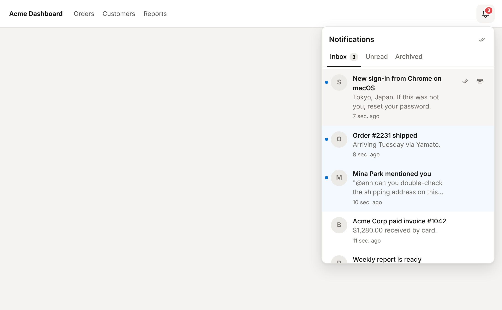
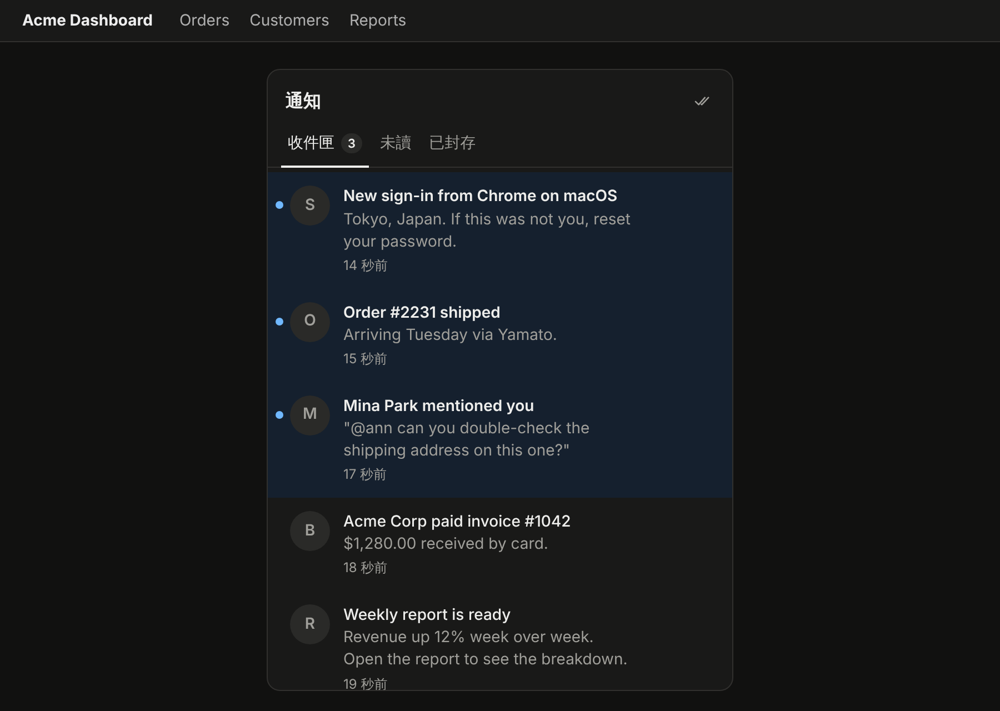
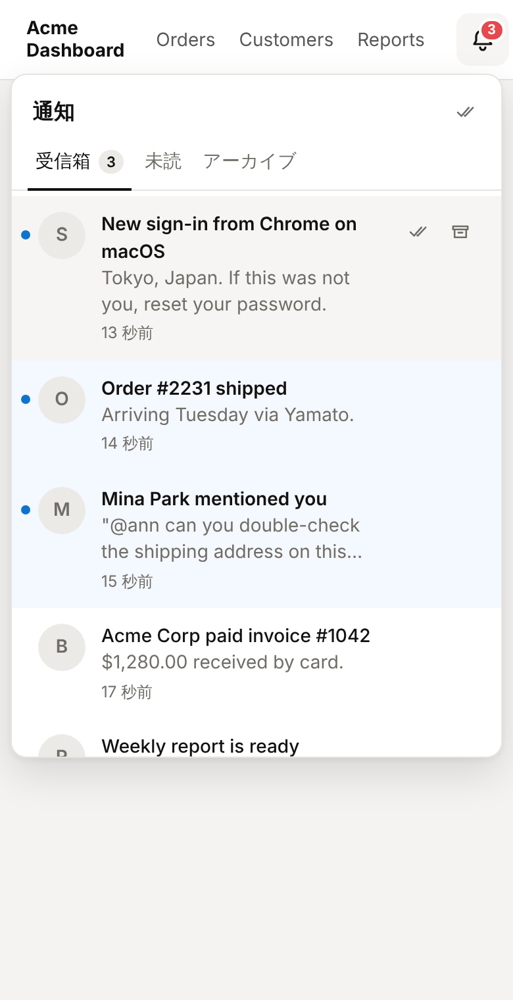

# @hibira-io/inbox

A drop-in notification inbox for your app: a bell with an unread badge, a
feed with read/unread and archive, live updates in every open tab, and a push
notification when the user is offline. Your server sends one request;
[Hibira](https://hibira.io) stores the notifications, delivers them in real
time and keeps the unread count right.

Components for **React**, **Vue** and **React Native** (Flutter widgets are the
[`hibira_inbox`](https://github.com/hibira-io/flutter/tree/main/packages/hibira_inbox) package). A self-hosted
alternative to Knock, Novu and Courier feeds, priced by your Hibira plan, not
per notification.

<p>
  
</p>
<p>
  
  
</p>

```sh
npm install @hibira-io/inbox pusher-js
```

## How it works

1. **Your server** sends a notification to one or more user IDs.
2. Hibira **stores** one per user, then sends it live to the user's open tabs
   and apps (the user's `#server-to-user-<id>` channel, after
   `pusher.signin()`), and **pushes** it through Hibira Push to users with no
   open connection.
3. **The browser or app** reads and marks its own feed directly, with a
   short-lived **user token** your server signs. No proxy endpoints.

## 1. Send from your server

```js
import { createInbox } from '@hibira-io/inbox';

const inbox = createInbox({
  appId: process.env.HIBIRA_APP_ID,
  key: process.env.HIBIRA_KEY,
  secret: process.env.HIBIRA_SECRET,
});

await inbox.send({
  users: ['ann', 'bob'],            // 1 to 1,000 user IDs
  title: 'Order #1042 shipped',
  body: 'It should arrive on Tuesday.',
  url: '/orders/1042',              // where a click goes
  category: 'orders',
  key: 'order-1042-shipped',        // idempotency: safe to retry
  data: { orderId: 1042 },
  push: 'offline',                  // 'offline' (default), 'always' or 'never'
});
```

Any language works: it is a signed `POST /apps/{app_id}/inbox/notifications`
like the rest of the Pusher-compatible HTTP API (see the
[API reference](https://github.com/hibira-io/pusher-server/blob/master/docs/inbox.md)).

## 2. Give the signed-in user a token

```js
// e.g. GET /api/inbox-token, behind your own login
app.get('/api/inbox-token', requireLogin, (req, res) => {
  res.json({ token: inbox.userToken(req.user.id) }); // HS256 JWT, 1 day
});
```

The token is a JWT signed with your app secret (`{"sub": userId, "exp": …}`,
at most 30 days). It only opens that user's own feed.

## 3. Show the bell

### React

```jsx
import Pusher from 'pusher-js';
import { NotificationBell, useInboxClient } from '@hibira-io/inbox/react';
import '@hibira-io/inbox/styles.css';

const pusher = new Pusher(KEY, {
  wsHost: 'ws.hibira.io', forceTLS: true, cluster: 'hibira',
  userAuthentication: { endpoint: '/pusher/user-auth' },
});
pusher.signin();

export function Header({ user }) {
  const client = useInboxClient({ appId: APP_ID, tokenUrl: '/api/inbox-token', pusher, userKey: user.id });
  return <header>{client && <NotificationBell client={client} />}</header>;
}
```

`<NotificationInbox client={client} />` renders the panel alone, for a page
of its own. Pass `onSelect={(n) => router.push(n.url)}` to handle clicks;
without it the browser follows `url`.

### Vue

```vue
<script setup>
import { onBeforeUnmount } from 'vue';
import { NotificationBell, createInboxClient } from '@hibira-io/inbox/vue';
import '@hibira-io/inbox/styles.css';

const client = createInboxClient({ appId: APP_ID, tokenUrl: '/api/inbox-token', pusher });
onBeforeUnmount(() => client.destroy());
</script>

<template>
  <NotificationBell :client="client" locale="zh-TW" @select="(n) => router.push(n.url)" />
</template>
```

### React Native

```jsx
import { NotificationBell, createInboxClient } from '@hibira-io/inbox/react-native';

const client = createInboxClient({ appId: APP_ID, token: () => api.get('/inbox-token').then((r) => r.token), pusher });

<NotificationBell client={client} onSelect={(n) => navigation.navigate('Order', n.data)} />
```

The bell opens the inbox in a sheet; `<NotificationInbox>` is the list for a
screen of its own. Use the `pusher` from
[`@hibira-io/react-native`](https://github.com/hibira-io/react-native), which
also registers the device for push.

### Your own UI

`@hibira-io/inbox/client` is the headless store the components use:

```js
import { createInboxClient } from '@hibira-io/inbox/client';

const client = createInboxClient({ appId, tokenUrl: '/api/inbox-token', pusher });
client.subscribe(({ items, unread, loading }) => render(items, unread));
client.onNotification((n) => showToast(n.title));
await client.markRead([id]);
await client.archive([id]);
await client.markAllRead();
client.setStatus('archived'); // '' (inbox), 'unread', 'read', 'archived', 'all'
```

Without `pusher` the client refreshes every minute while the page is
visible (`pollInterval`).

## Options

| `createInboxClient` | |
|---|---|
| `appId` | your Hibira app ID |
| `token` / `tokenUrl` | the user token (a string or a function that fetches one), or a URL answering `{"token"}`; fetched again before it expires |
| `pusher` | a pusher-js instance signed in as the user, for live updates |
| `host` | the HTTP API host, default `api.hibira.io` |
| `pageSize` | default 20 |

| Components | |
|---|---|
| `locale` | `en`, `zh-TW`, `zh-CN`, `ja`, `ko`, `th`, `vi` |
| `labels` | override any string, e.g. `{ tabs: { archived: 'Done' } }` |
| `tabs` | default `['', 'unread', 'archived']` |
| `onSelect` | click handler (Vue: `@select`) |
| `align` | bell popover side, `end` (default) or `start` |

Styling: every color is a CSS variable on `.hb-in-root` / `.hb-in`
(`--hb-in-accent`, `--hb-in-badge`, `--hb-in-bg`, …). Dark mode follows
`prefers-color-scheme`, or set `data-theme="dark"` on any ancestor.

## Limits

Notifications are kept 7 days on Free, 30 days on Hobby and Starter, 90 days
on Pro and up; each user keeps the newest 1,000. Each recipient counts as one
message of the app's daily quota.

## 中文摘要

`@hibira-io/inbox` 是建立在 Hibira 上的通知中心模組：鈴鐺與未讀數、已讀／未讀、封存、多分頁即時同步，離線使用者自動改用推播。伺服器端呼叫 `inbox.send()` 送出，前端用伺服器簽發的使用者 token 直接讀取自己的通知，不需要自己寫轉接 API。提供 React、Vue、React Native 元件（Flutter 版為 `hibira_inbox` 套件），內建繁中、簡中、日、韓、泰、越與英文介面。

## License

MIT
